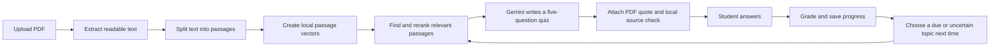

# EchoPilot: a beginner's guide

EchoPilot helps a student practice from their own PDF files. Each uploaded file has its own quizzes and progress. This guide explains how the app finds material, creates questions, checks answers, and chooses what to practice next.

## The flow in a nutshell

## What the different AI-related parts do

- **Gemini (generative AI):** writes question text, answer choices, answer keys, explanations, topic names, and difficulty labels. It receives selected passages, not the entire PDF.
- **Embeddings (semantic search):** a local model turns each passage into a list of numbers. Passages with related meanings tend to have vectors closer together. EchoPilot uses BGE Small through Transformers.js and ONNX; Gemini is not used to create embeddings.
- **BM25 (keyword search):** scores passages using query-term frequency and rarity. It helps catch exact terms that semantic search may miss.
- **Reciprocal Rank Fusion:** combines the BM25 and embedding result orderings. Since each ranking may use a different score scale, RRF combines ranks instead of comparing raw scores.
- **Cross-encoder reranking:** a local model reads a query and one passage together, then scores their relevance. EchoPilot uses this score to improve the order of the candidate passages.
- **Natural Language Inference (NLI):** a local classifier compares a source passage with a sentence stating the correct answer and explanation. It marks the source as supported, needing review, or unchecked. It is a warning signal, not a truth guarantee.
- **Bayesian Knowledge Tracing (BKT):** a simple learner model estimates how likely the student is to know a topic, using correct and incorrect answers while accounting for guesses and accidental errors.
- **Adaptive scheduling:** uses the BKT estimate, expected information gain, time since last review, and recent mistakes to choose a topic. Correct answers extend the review interval; wrong answers reset it. It no longer relies on a single mastery cutoff.

## How an upload is processed

1. The browser sends a PDF to the Express server.
2. `pdf-parse` extracts text. PDFs with too little readable text are rejected; the app does not perform OCR on scanned pages.
3. Text is split into passages up to around 1,200 characters. Long passages overlap a little so a sentence near a boundary is not lost from both chunks.
4. BGE Small creates a normalized 384-number vector for each passage. The server caches the vectors per material so it does not need to re-embed unchanged text on each quiz.
5. On first use, Transformers.js downloads the local model weights and keeps them in `server/data/model-cache/`. After download, this retrieval model runs locally.

If local embedding cannot run, the PDF still remains saved and quiz retrieval can use BM25 keywords. Existing quiz history is not deleted when a passage index must be rebuilt for a new embedding model.

## How EchoPilot finds the passages for a quiz

The quiz topic is turned into a search request. BM25 finds passages with matching words; vector search finds passages with similar meanings. RRF merges those rankings. The local MiniLM cross-encoder then compares the request with top candidate passages and sorts them again. EchoPilot gives the best seven passages to Gemini as the allowed source material.

This is a Retrieval-Augmented Generation (RAG) pipeline: retrieve relevant text first, then provide that text to a generative model. Passage ranking can still miss context or choose a related but incomplete excerpt. The synthetic ranking data and `npm run evaluate:retrieval` command help measure ranking changes, but a small synthetic dataset is not representative of every class PDF.

## How questions are created and checked

Gemini is prompted to create exactly five multiple-choice questions grounded in the retrieved excerpts. Each question needs four distinct options, one answer index, and a source-aligned explanation. The backend checks the response structure, duplicate text/options, answer-index range, topic focus, and difficulty label. If validation fails, the backend asks Gemini to repair the draft up to two times.

After that, the local reranker chooses a likely source passage for each question. EchoPilot attaches a short excerpt copied from the PDF text itself. MobileBERT NLI compares that passage with a statement containing the answer and explanation. The result is shown as a source check. Because NLI models can be uncertain or wrong, students should still read the quote when checking an answer.

The student response is graded by the server with a direct comparison: selected option index equals the answer index. Gemini does not grade the quiz.

## How progress changes future quizzes

Each material has separate topic estimates. For each response, BKT updates a probability called `pKnown`. The initial estimate and the guess, slip, and learning settings are project defaults. They have not been fitted using a large student dataset, so a displayed score should be read as a rough model estimate.

The topic scheduler estimates which question is likely to teach the system the most about a student's current knowledge. Topics with more uncertainty can have greater expected information gain. It also raises priority when a topic is due for review or has recent wrong answers. A correct streak increases the time before that topic is due again; a wrong answer makes it due again immediately. Gemini receives the mastery estimate and recent accuracy as continuous difficulty guidance, but as a language model it may not follow that guidance perfectly every time.

This is adaptive learner modeling and information-guided scheduling. It is not reinforcement learning, it does not train itself on student data, and it cannot promise an optimal learning path.

## Where data goes

| Data | Location | Used for |
|---|---|---|
| Original PDFs | `server/data/uploads/` | Stored materials |
| Material text, quizzes, answers, progress | `server/data/db.json` | App state and quiz history |
| Passage vectors | `server/data/embeddings/` | Faster local semantic search |
| Downloaded model files | `server/data/model-cache/` | Local ONNX inference |

PDF extraction, embeddings, retrieval, reranking, and NLI run locally. The selected quiz passages and prompt are sent to Google Gemini for question generation. Keep private materials out unless sending those excerpts to the Gemini API is acceptable to you.

## Important limitations

- Gemini can make an incorrect question or answer key even when its output passes the format checks.
- The local source-support result is a classifier estimate; it can miss unsupported answers or flag valid paraphrases.
- BKT and the review interval are transparent heuristics with hand-set starting values, not calibrated predictions.
- Scanned image PDFs need OCR, which is not part of this project.
- Local model weights need to download once and use local compute; the quiz-writing step still requires a working Gemini API key and quota.
- The app saves state locally for one user and is not designed as a multi-user production service.

## Main files

- `server/index.js` — API routes, PDF extraction, Gemini calls, quiz validation, scoring, progress storage.
- `server/ai.js` — chunking, local model loading, embeddings, retrieval, reranking, NLI check, BKT, topic scheduling.
- `server/evaluation/retrieval-cases.json` — synthetic retrieval examples with expected passage labels.
- `server/evaluate-retrieval.js` — compares BM25 and hybrid retrieval using Recall@7 and MRR.
- `src/App.jsx` — app views, quiz UI, and support-check feedback.
- `GEMINI_API_IMPLEMENTATION.md` — technical implementation details.
