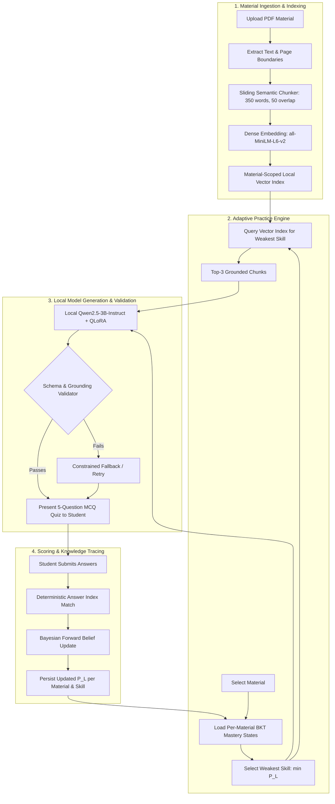

# EchoPilot: Machine Learning Implementation & Transition Plan

## 1. Executive Summary & Goal

This document defines the architecture, model specifications, training pipelines, and evaluation protocols to transition **EchoPilot** from cloud API dependencies (Google Gemini API) to **100% local, edge-deployable open-source machine learning models**.

EchoPilot will continue serving its full educational workflow:
1. **Material-Isolated Processing**: Separate PDF textbooks and lecture notes with independent progress maps.
2. **Offline Dense Semantic Retrieval**: Local vector indexing ensuring questions are grounded strictly in the chosen study material.
3. **Structured Question Generation**: Local language models generating pedagogically valid 4-option multiple-choice questions with answer keys, evidence citations, and explanations.
4. **Principled Knowledge Tracing**: Replacing heuristic moving averages with **Bayesian Knowledge Tracing (BKT)** (with DKT neural benchmarks) to estimate mastery probabilities per skill.
5. **Adaptive Question Selection**: Dynamically targeting the learner's weakest skill in that specific material and selecting appropriate difficulty levels.

> **Operational Continuity**: The production web application (`server/index.js` and `src/App.jsx`) continues to run on the Gemini API without disruption. All code, datasets, and notebooks required for this ML transition are implemented in the `ml_research/` research suite.

---

## 2. Selected Models & Technical Justification

| Role / Job | Primary Model Choice | Alternative Checkpoints | What It Does / Learns | Training / Fine-Tuning Strategy |
|---|---|---|---|---|
| **Question Generation & Explanation** | **`Qwen/Qwen2.5-3B-Instruct`** [HF Link](https://huggingface.co/Qwen/Qwen2.5-3B-Instruct) | `Qwen/Qwen2.5-1.5B-Instruct` (low-RAM CPU) or `meta-llama/Llama-3.2-3B-Instruct` | Generates structured 4-option MCQs strictly grounded in retrieved evidence chunks for a specified skill and difficulty. | **QLoRA (4-bit NF4)** adapter trained over human-reviewed items. Targets attention (`q, k, v, o`) and MLP projections. Base weights remain frozen. |
| **Passage Retrieval & Indexing** | **`sentence-transformers/all-MiniLM-L6-v2`** [HF Link](https://huggingface.co/sentence-transformers/all-MiniLM-L6-v2) | `BAAI/bge-small-en-v1.5` | Encodes 300–400 word chunks into 384-dimensional dense vectors for sub-10ms cosine similarity search. | Pretrained zero-shot first. Fine-tuned with MultipleNegativesRankingLoss if Recall@5 < 0.90 on course-specific vocabulary. |
| **Skill Mastery Tracking** | **Bayesian Knowledge Tracing (BKT)** | **Deep Knowledge Tracing (DKT)** (LSTM baseline) | 2-state Hidden Markov Model tracking latent skill mastery $P(L_t \in \{0, 1\})$ over sequential quiz opportunities. | Fit parameters $P(L_0), P(T), P(G), P(S)$ via **Baum-Welch Expectation-Maximization (EM)** on student interaction traces. |

### Why `Qwen2.5-3B-Instruct` instead of speculative 4B checkpoints?
1. **Real Open Weights & Licensing**: Apache-2.0 license with active community support, GGUF/llama.cpp quantization, and Hugging Face Transformers integration.
2. **Context & Reasoning**: Native support for up to 32k context, robust ChatML formatting, and competitive MMLU/instruction benchmarks rivaling 7B models.
3. **Memory Footprint**:
   - 4-bit quantized base model consumes ~2.2 GB VRAM.
   - LoRA adapter (rank 16) adds only ~25 MB of trainable parameters.
   - Enables fast inference even on standard student laptops with integrated GPUs or 16 GB system RAM.

---

## 3. Mathematical Foundations of Knowledge Tracing

In the current Express app, mastery is updated using a simple heuristic:
$$S_{t+1} = 0.72 \cdot S_t + 0.28 \cdot (100 \text{ if correct else } 0)$$

While functional for UI display, this heuristic is not a true statistical estimate of knowledge. The ML implementation introduces **Bayesian Knowledge Tracing (Corbett & Anderson, 1995)**:

### 3.1 BKT State & Parameters
A student's knowledge of skill $k$ at opportunity $t$ is a latent binary state $L_t \in \{0, 1\}$ (0 = Unmastered, 1 = Mastered). The model defines four parameters per skill:
- **$P(L_0)$**: Prior probability that the learner has mastered the skill prior to any practice.
- **$P(T)$**: Probability of transitioning from unmastered to mastered: $P(L_{t+1} = 1 \mid L_t = 0)$.
- **$P(G)$**: Guess probability: $P(\text{obs}_t = 1 \mid L_t = 0)$.
- **$P(S)$**: Slip probability: $P(\text{obs}_t = 0 \mid L_t = 1)$.

### 3.2 Forward Bayesian Update
Upon observing whether student answer $t$ is correct ($\text{obs}_t \in \{0, 1\}$):

1. **Posterior Probability**:
   $$P(L_t \mid \text{obs}_t = 1) = \frac{P(L_t) \cdot (1 - P(S))}{P(L_t) \cdot (1 - P(S)) + (1 - P(L_t)) \cdot P(G)}$$
   $$P(L_t \mid \text{obs}_t = 0) = \frac{P(L_t) \cdot P(S)}{P(L_t) \cdot P(S) + (1 - P(L_t)) \cdot (1 - P(G))}$$

2. **Transition to Opportunity $t+1$**:
   $$P(L_{t+1}) = P(L_t \mid \text{obs}_t) + (1 - P(L_t \mid \text{obs}_t)) \cdot P(T)$$

3. **Predicted Performance**:
   $$P(\text{correct}_{t+1}) = P(L_{t+1}) \cdot (1 - P(S)) + (1 - P(L_{t+1})) \cdot P(G)$$

### 3.3 Parameter Estimation via Baum-Welch (EM)
Parameters are fit from student response sequences by maximizing the log-likelihood over hidden state distributions:
- **E-Step**: Compute forward probabilities $\alpha_t(i)$ and backward probabilities $\beta_t(i)$ to calculate state posterior $\gamma_t(i) = P(L_t = i \mid \mathbf{O})$ and transition posterior $\xi_t(i, j) = P(L_t = i, L_{t+1} = j \mid \mathbf{O})$.
- **M-Step**: Update parameter estimates with bounded constraints:
  $$P(L_0) = \frac{1}{N} \sum_{n=1}^N \gamma_1^{(n)}(1), \quad P(T) = \frac{\sum_{t} \xi_t(0, 1)}{\sum_t \gamma_t(0)}, \quad P(G) = \frac{\sum_{t, \text{obs}=1} \gamma_t(0)}{\sum_t \gamma_t(0)}, \quad P(S) = \frac{\sum_{t, \text{obs}=0} \gamma_t(1)}{\sum_t \gamma_t(1)}$$

---

## 4. End-to-End Local Architecture & Data Flow

---

## 5. Structured Output Guarantee (Grammar-Guided Decoding)

To avoid hallucinations, invalid option counts, and mismatched answer indices:
1. **Schema Definition**: A strict JSON Schema specifies `questions` (array of length 5), `options` (array of length 4, distinct strings), `answer` (integer 0–3), `explanation` (non-empty string), and `source_chunk_id`.
2. **Constrained Generation**:
   - Hugging Face / vLLM / llama.cpp allows grammar-based sampling (via JSON BNF grammars or `outlines` regex constraints), guaranteeing 100% syntactic JSON validity without post-generation retries.
3. **Application Validation Layer**:
   - Located in `ml_research/src/generator.py` (`validate_and_parse_quiz_json`).
   - Ensures distinct options, non-trivial answer explanations, and verified citations.

---

## 6. Research Deliverables in `ml_research/`

The codebase now includes a complete, executable research and transition workspace:

### 6.1 Executable Jupyter Notebooks
- **`notebooks/01_document_parsing_and_chunking.ipynb`**: Page-level PDF extraction, heading recognition, sliding chunker, and contrastive dataset creation.
- **`notebooks/02_semantic_retrieval_and_indexing.ipynb`**: Dense vector indexing, cosine similarity, material-level isolation verification, and Recall@K / MRR@K evaluation.
- **`notebooks/03_qlora_question_generation_finetuning.ipynb`**: ChatML dataset formatting, 4-bit bitsandbytes configuration, LoRA adapter setup, and TRL SFTTrainer pipeline.
- **`notebooks/04_knowledge_tracing_bkt_and_dkt.ipynb`**: BKT Expectation-Maximization parameter fitting, Bayesian forward belief progression, and PyTorch Deep Knowledge Tracing (DKT with LSTM) comparative benchmark.
- **`notebooks/05_end_to_end_local_pipeline_eval.ipynb`**: Full simulated offline workflow testing document ingestion -> retrieval -> quiz generation -> student scoring -> BKT updates -> adaptive selection.

### 6.2 Modular Python Source Packages (`ml_research/src/`)
- `chunker.py`: Page-aware PDF parser and sliding window text chunker.
- `retriever.py`: `MaterialVectorStore` with dense embeddings and Recall@K / MRR@K evaluators.
- `generator.py`: Prompt builder and deterministic JSON schema validator.
- `bkt.py`: Full Bayesian Knowledge Tracing model with Baum-Welch EM and calibration metrics.
- `dkt.py`: PyTorch Deep Knowledge Tracing recurrent network.

### 6.3 Local ML Microservice (`ml_research/service/`)
- `app.py`: FastAPI server replicating the `/api/health`, `/api/quiz`, and `/api/quiz/submit` routes.
- `test_service.py`: Automated pytest test suite verifying exact contract compatibility with the React frontend (`src/App.jsx`).

---

## 7. Zero-Disruption Transition Path

When shifting from the Gemini API to local models:
1. **Frontend**: No changes required. The React UI continues calling `/api/quiz` and `/api/quiz/submit`.
2. **Backend**:
   - Option A: Run `ml_research/service/app.py` on port 8000 and update Vite's development proxy.
   - Option B: Add a lightweight HTTP forwarder in `server/index.js` when `process.env.ML_BACKEND === 'local'`.
3. **Hardware Readiness**:
   - With `Qwen2.5-3B-Instruct` in 4-bit and `all-MiniLM-L6-v2`, the entire stack runs locally inside 4 GB total RAM/VRAM.
