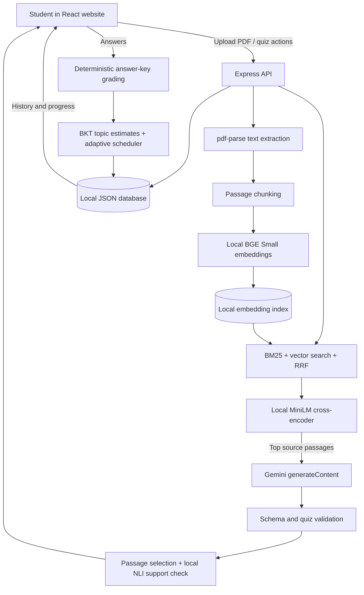

# EchoPilot — Project Report and Presentation Guide

**Project type:** College project / local web application<br>
**Project area:** Educational technology, generative AI, information retrieval, and learner modeling<br>
**Prepared:** November 2026

## 1. Project summary

EchoPilot is an AI-assisted personal learning tutor. A student uploads a readable PDF, chooses that material, takes a short quiz, reviews answers with excerpts from the PDF, and sees their progress recorded for that material. Later quizzes use past performance to choose a topic that may benefit from more practice.

The central idea is to combine a language model with several smaller, more specific techniques. Gemini writes the quiz, while local models and algorithms find relevant passages, estimate topic knowledge, rank what to review next, and check whether the source appears to support an answer.

### Problem statement

Students often have notes and readings but must decide by themselves what to study, how to check their understanding, and what to revisit after getting something wrong. A generic quiz may not match their course material or their current knowledge.

### Proposed solution

EchoPilot turns each uploaded PDF into a separate source of study material. It retrieves related excerpts for a quiz, uses those excerpts as context for question generation, grades selected options, stores quiz history and topic estimates, and uses that state to guide later practice.

### Project goals

- Let a student upload and manage individual PDF materials.
- Generate material-grounded multiple-choice quizzes.
- Give clear scoring, explanations, and source excerpts.
- Save quiz and topic progress separately for each material.
- Use prior answers and review timing to guide the next topic.
- Keep retrieval and answer-support models local after their initial model download.

### Current scope

The app is designed for a single local user and a college demonstration. It includes material upload, material-specific quizzes, answer feedback, progress history, a backend API, Gemini quiz generation, local retrieval models, and local JSON/file storage. It is not a production multi-user learning platform.

## 2. What a user does

1. Open the EchoPilot website.
2. Upload a text-readable PDF in **My materials**.
3. Choose **Take a quiz** and select that PDF.
4. Answer five multiple-choice questions.
5. Review the score, explanation, PDF excerpt, and local source-check label.
6. Visit **My progress** to see material-level averages and open previous quizzes to review their questions.
7. Take another quiz. The backend uses the saved topic estimates, recent mistakes, and review timing to select a topic for practice.

Every material keeps its own quiz history and mastery map, so studying one PDF does not directly change the recorded progress for another PDF.

## 3. System architecture



### Main technologies

| Part | Technology | Responsibility |
|---|---|---|
| User interface | React, Vite, Lucide icons, CSS | Materials, quizzes, feedback, and progress screens |
| Backend | Node.js and Express | API routes, uploads, AI orchestration, grading, and persistence |
| PDF extraction | `pdf-parse` | Extracts text from text-based PDFs |
| Quiz generation | Google Gemini `generateContent` | Writes a structured quiz from selected PDF excerpts |
| Local model runtime | Transformers.js and ONNX | Runs embedding, reranking, and NLI models locally |
| Persistence | JSON and local files | Stores PDFs, extracted text, indexes, quizzes, and progress |

### Important code locations

- `src/App.jsx` — screen navigation, upload flow, quiz interaction, result feedback, and progress history.
- `src/styles.css` — visual styles and responsive layout.
- `server/index.js` — Express endpoints, PDF upload, Gemini prompt/validation, grading, and database updates.
- `server/ai.js` — chunking, local model loading, embeddings, hybrid retrieval, evidence checks, BKT, and topic scheduling.
- `server/evaluation/retrieval-cases.json` — small synthetic retrieval evaluation set.
- `server/evaluate-retrieval.js` — BM25 and hybrid retrieval metrics runner.
- `.env` — local secrets and settings. Never put a real key in a presentation, screenshot, or source control.

## 4. End-to-end processing flow

### A. PDF upload and text extraction

The browser sends one PDF to `POST /api/materials`. Express receives the file in memory, with a 20 MB upload limit, then `pdf-parse` extracts its text. The backend rejects files with fewer than 30 readable characters, which commonly includes scanned image-only PDFs.

For a valid PDF, the server saves the original file, stores material metadata and extracted text in `server/data/db.json`, and tries to build a local passage index. Indexing failures do not discard the uploaded material; the server logs the issue and can use keyword retrieval when needed.

### B. Chunking and indexing

The extracted text is normalized into paragraph-like blocks. A long block is split into pieces of roughly 1,200 characters, with an overlap of about 140 characters. Nearby blocks are grouped without exceeding the same approximate chunk size. Each passage gets an ID such as `C001`.

Chunking matters because whole books are too large and unfocused to use as the context for every question. Smaller passages let retrieval select a focused set of evidence, and overlap helps retain context around split boundaries.

The server calculates a SHA-256 hash of the material text. If a cached index has the same content hash, model ID, vector dimension, and chunk count, it reuses that index. If not, it regenerates the vectors and replaces the index file. Quiz history and learner state are stored separately, so rebuilding vectors does not clear progress.

### C. Finding the source passages

For a returning learner, the selected topic becomes part of the search query. On a material's first quiz, the query asks for foundational concepts. The app uses a retrieval pipeline described in Section 5 to produce up to seven passages.

### D. Generating the quiz

The backend builds a Gemini prompt containing the material name, target topic when one exists, current mastery estimates, recent accuracy, retrieval mode, and the selected passages. It asks Gemini for exactly five multiple-choice questions, four distinct options per question, one zero-based correct-option index, an explanation, a topic, and a difficulty label.

The server requests JSON output with a schema and temperature `0.35`. It then checks the response itself. If the draft is invalid, the server sends the validation reason and draft back for repair, for up to two repair attempts after the initial generation.

### E. Supporting evidence

For each question, the backend reranks the retrieved passages using the question and keyed answer. It chooses a likely passage, picks a sentence excerpt from the actual extracted PDF text, and runs a local Natural Language Inference (NLI) model on the passage and a statement containing the correct answer and explanation.

The support label is advisory. If the NLI model is unavailable, the answer still has a source excerpt and the check is stored as unavailable. A model's “supported” label is not a mathematical proof that a generated answer is correct.

### F. Answering and saving progress

The quiz screen displays one question at a time. On submission, the backend checks each selected option index against the answer index in the quiz object. It calculates the quiz score as:

`score = round(number of correct answers / number of questions × 100)`

For every question, the server saves the prompt, topic, options, selected option, correct option, correctness, explanation, difficulty, evidence excerpt, and support-check status in the attempt record. It then updates BKT for that material and topic, updates the per-topic review interval, saves the attempt, and returns the updated progress.

## 5. AI, algorithms, and concepts to explain

This section is suitable for the technical part of a presentation. A useful distinction is: Gemini is the generative model, while retrieval, mastery tracking, scheduling, and grading are separate components around it.

### 5.1 Generative AI and prompt constraints

**What it means:** Generative AI creates new text in response to an instruction. Gemini is a pre-trained large language model (LLM); EchoPilot does not train or fine-tune Gemini.

**How it is used:** Gemini receives a prompt and a small set of selected source passages. It returns structured quiz JSON. The prompt asks it to remain within the passages, avoid ambiguous or duplicate questions, use four distinct options, and make the explanation agree with the answer key.

**Why the server validates afterward:** A prompt is guidance, not a guarantee. Schema validation checks that there are five questions, valid fields, four unique options, valid answer indexes, unique question text, and the required topic label. These checks catch format defects, but cannot catch every factual or reasoning error.

**What to say:** “Gemini proposes a quiz, but our backend checks the shape and topic of the result before showing it. We also attach source text from the PDF rather than asking the model to invent a quote.”

### 5.2 Embeddings and semantic search

**What an embedding is:** An embedding is a vector—a list of numbers—that represents text. A model learns to place text with related meaning near each other in vector space. For example, “force equals mass times acceleration” may be semantically close to a question about Newton's second law even if the wording is different.

**EchoPilot's model:** `Xenova/bge-small-en-v1.5`, loaded through Transformers.js/ONNX. It generates 384-dimensional vectors. The query is prefixed with an instruction for searching relevant passages. The passage and query vectors are normalized, then cosine similarity is used to compare direction/semantic closeness.

For normalized vectors, cosine similarity can be written as:

`cosine(q, d) = q · d`

where `q` is the query vector, `d` is the document-passage vector, and `·` is the dot product. A larger value means the vectors point in a more similar direction.

**Why local embeddings:** They avoid calling Gemini for every passage vector and keep the embedding step on the student's machine after the model is downloaded. Gemini remains necessary for writing quiz questions. The first model use requires a download and local storage/compute.

### 5.3 BM25 keyword retrieval

**What it is:** BM25 is a traditional information-retrieval ranking algorithm. It scores a passage using three useful signals:

- **Term frequency:** Does the passage contain the query term, and how often?
- **Inverse document frequency:** Is the term rare across the material? A rare, specific term is often more useful than a common one.
- **Length normalization:** Does the passage match well without receiving an unfair advantage just because it is much longer?

EchoPilot uses BM25 constants `k1 = 1.5` and `b = 0.75`, a common style of BM25 configuration. It tokenizes text, removes common/low-value query words, calculates term frequencies and document frequencies, and ranks passages by score.

**Why keep BM25 alongside embeddings:** Exact names, formulas, and specialized vocabulary may be important even when a semantic model ranks paraphrases well. BM25 supplies a complementary lexical signal.

### 5.4 Reciprocal Rank Fusion (RRF)

BM25 and vector similarity use different score scales. Directly adding their raw scores could let one method dominate just because its values are numerically larger. RRF combines the rank order instead.

For a passage at one-based rank `r`, one ranking contributes:

`1 / (k + r)`

EchoPilot uses `k = 60`. The contributions from the semantic and BM25 rankings are added. Passages that rank well in both lists tend to rise in the fused list. The strongest candidates go to the reranker.

### 5.5 Cross-encoder passage reranking

**What it is:** A bi-encoder embedding search first compares precomputed passage vectors with a query, which is fast. A cross-encoder instead reads the query and a candidate passage together and gives that pair a relevance score. This lets it examine word interactions more directly, but it costs more compute per candidate.

**EchoPilot's model:** `Xenova/ms-marco-MiniLM-L-6-v2`. The app uses it after the fast first retrieval stage, on a smaller candidate list, to sort likely passages more carefully. It also selects a likely passage to support each generated question.

**Why use both stages:** Embeddings and BM25 efficiently narrow a large PDF to candidates. The slower pair model improves the order of those candidates without scoring every passage in the material.

### 5.6 Retrieval-Augmented Generation (RAG)

RAG means that the application retrieves useful external text and includes it in a generative model's prompt. In EchoPilot:

1. **Retrieve:** Find relevant passages in the learner's selected PDF.
2. **Augment:** Add those passages to the Gemini instructions.
3. **Generate:** Ask Gemini to make a quiz from the supplied evidence.

RAG gives the model course-specific context. It does not eliminate hallucinations or make the model's answer automatically correct. The source excerpts and validation make errors easier to inspect.

### 5.7 Bayesian Knowledge Tracing (BKT)

**Purpose:** BKT is a probabilistic learner model used to estimate whether a learner has mastered a skill or topic. It uses response correctness as evidence but acknowledges that a learner may guess correctly or make a careless error.

For each material-topic pair, EchoPilot stores a mastery probability `pKnown`, a display score, an answer count, an update timestamp, a correct streak, and a review interval.

The shared BKT parameters are learned from public ASSISTments Skill Builder interactions using Baum-Welch Expectation-Maximization (EM):

| Symbol | Code setting | Meaning |
|---|---:|---|
| `P(L0)` | 0.7306 | Initial probability the learner already knows the topic |
| `P(T)` | 0.0311 | Probability of learning the topic after an opportunity |
| `P(G)` | 0.3193 | Probability of a correct guess without knowing the topic |
| `P(S)` | 0.2313 | Probability of a mistake even when the topic is known |

Let `p` be the current probability of knowing the topic.

After a correct response, the knowledge probability before the learning transition is:

`posterior = p(1 - P(S)) / [p(1 - P(S)) + (1 - p)P(G)]`

After an incorrect response:

`posterior = pP(S) / [pP(S) + (1 - p)(1 - P(G))]`

Then the implementation applies the learning transition:

`new pKnown = posterior + (1 - posterior)P(T)`

The result is kept between 0.001 and 0.999. The displayed topic score is `round(100 × pKnown)`.

**Dataset and fitting process:** We used the corrected/collapsed [ASSISTments 2009–2010 Skill Builder dataset](https://sites.google.com/site/assistmentsdata/home/2009-2010-assistment-data/skill-builder-data-2009-2010), a historical math mastery-learning dataset. The official page notes duplicates in the original files; the corrected file has one row per student-problem and combines multiple skill tags into labels such as `skill1_skill2`. The trainer keeps each composite tag as a single label. Its `correct` outcome is 1 for correct on the first attempt and 0 for incorrect on the first attempt or help requested. This run used 346,860 valid responses from 4,217 students and 113 skill labels. Responses were grouped by student and skill, ordered using `order_id`, and split by student using seed 42: 3,374 students for training, 843 for holdout. BKT parameters were fitted with Baum-Welch EM on a deterministic sample of 6,000 sequences and evaluated across 72,252 responses from all 7,958 held-out sequences. No student appears in both groups. The steps are available in the executed `ml_research/notebooks/01_assistments_bkt_calibration.ipynb` notebook and its matching command-line script.

**Evaluation results:** The former app settings were `P(L0)=0.30`, `P(T)=0.15`, `P(G)=0.25`, `P(S)=0.10`; the fitted values are `0.7306`, `0.0311`, `0.3193`, and `0.2313` respectively.

| Metric | Former settings | Fitted BKT | Change | Beginner explanation |
|---|---:|---:|---:|---|
| Brier score | 0.221969 | **0.206817** | 6.83% lower | Average squared error of predicted correctness probabilities. Lower is better. |
| Log loss | 0.653067 | **0.603175** | 7.64% lower | Penalizes predictions that are confidently wrong. Lower is better. |
| AUC-ROC | 0.656065 | **0.659295** | +0.003230 | Measures whether correct answers tend to receive higher predicted probabilities. Higher is better. |
| ECE | 0.104846 | **0.016676** | 84.09% lower | Measures the gap between predicted confidence and observed accuracy. Lower is better. |

All four metrics improved on the held-out students. The largest gain was calibration, while ranking ability improved modestly. Results are recorded in `ml_research/results/assistments_bkt.json`; the app reads the fitted values from `server/bkt-parameters.json`.

**Important interpretation:** This improves response prediction in the historical ASSISTments math data. It does not prove EchoPilot improves learning or that these values match every PDF, subject, or Gemini quiz. The fitted values supply a shared starting prior; each material-topic mastery estimate is still updated from the current learner's own answers. Existing progress is not reset. The raw public CSV stays in ignored `ml_research/data/raw/` and is not included in Git.

### 5.8 Expected information gain and adaptive topic scheduling

The earlier design chose topics using a fixed mastery cutoff. The current design scores known topics using several signals, so the next topic is not decided by one “below 75%” rule.

**Entropy:** Entropy describes uncertainty in a probability. A mastery estimate near 50% is more uncertain than one near 1% or 99%. For probability `p`:

`H(p) = -p log2(p) - (1-p) log2(1-p)`

**Expected information gain (EIG):** A new response may be correct or incorrect. EIG estimates the current uncertainty minus the average uncertainty expected after those possible responses:

`EIG = H(p) - [P(correct)H(p after correct) + P(wrong)H(p after wrong)]`

In the implementation, the probability of a correct response is estimated from the BKT guess and slip parameters:

`P(correct) = p(1 - P(S)) + (1 - p)P(G)`

The topic score then includes EIG, whether the topic is due, recent errors, and lower mastery:

`selection score = EIG × (1 + due factor) + 0.35 × recent error rate + 0.10 × (1 - pKnown)`

The due factor grows with elapsed time relative to the topic's stored review interval and is capped at 2. An interval of zero means the topic is immediately due. The highest-scoring topic is selected. The recent error rate is calculated from up to ten saved responses for that topic.

Correct responses extend an interval, up to 30 days, using the current BKT estimate. A wrong response resets the interval to zero. The initial interval is about one day. These are transparent scheduling heuristics; they have not been experimentally optimized.

**Difficulty guidance:** The prompt supplies mastery and recent accuracy as continuous signals. Gemini is asked to favor clear recall when confidence is low, increase application as confidence rises, and include a modest stretch question when the learner is doing well. The labels `gentle`, `steady`, and `stretch` are generated by Gemini; the prompt guides these labels, but the model may not follow perfectly.

**AI domain:** learner modeling, adaptive learning, information theory, and spaced practice. The project does not use reinforcement learning and does not train a policy from student data.

### 5.9 Natural Language Inference (NLI) source check

**What NLI does:** NLI takes two pieces of text—a premise and a hypothesis—and classifies the relationship as entailment, neutral, or contradiction. Here, the selected PDF passage is the premise. A statement containing the quiz's keyed answer and explanation is the hypothesis.

**EchoPilot's model:** `Xenova/mobilebert-uncased-mnli`, run locally. The app reads its output probabilities and marks a check supported when entailment is at least 0.55 and exceeds contradiction. Otherwise it suggests review. If model inference fails, the status is unchecked.

**Why it is useful:** It provides an additional check beyond word overlap: a quote containing similar terms is not necessarily evidence that the answer is correct.

**Limit:** NLI is a classifier trained on other examples. It may miss context, struggle with technical or mathematical text, or misjudge paraphrases. “Supported” means the model estimates entailment; it does not prove factual accuracy.

### 5.10 Deterministic grading and persistence

Grading does not call Gemini. The backend compares the student's selected option number with the quiz's answer index. This makes the arithmetic reproducible, provided the quiz's answer key is valid.

The backend saves the attempt and updated mastery to local JSON. This lets progress persist through app restarts, but the JSON approach is intended for a simple single-user demonstration, not concurrent or multi-user production use.

## 6. Data and privacy flow

| Data | Local location | Purpose |
|---|---|---|
| Original uploaded PDFs | `server/data/uploads/` | Keep the uploaded material available |
| Material details and extracted PDF text | `server/data/db.json` | Build quizzes and list materials |
| Quiz attempts, questions, answers, evidence, and mastery | `server/data/db.json` | Results, history, and adaptation |
| Passage vectors | `server/data/embeddings/` | Reuse local semantic search vectors |
| Downloaded model weights | `server/data/model-cache/` | Run local Transformers.js/ONNX models |

Embedding, first-stage retrieval, reranking, and NLI run locally after initial model downloads. The selected passage text and quiz instructions are sent to Google Gemini for quiz generation. Do not upload private material unless sending these excerpts to Gemini is acceptable.

Runtime data, model cache, `.env`, `node_modules`, and `dist` are ignored by Git. Keep the Gemini key in `.env`; never commit it or include it in screenshots.

## 7. API routes

| Route | Purpose |
|---|---|
| `GET /api/health` | Reports API health and whether a Gemini key is configured (not the key itself). |
| `GET /api/state` | Returns material summaries, attempts, and per-material mastery. |
| `POST /api/materials` | Accepts a PDF, extracts readable text, saves the material, and starts indexing. |
| `DELETE /api/materials/:id` | Removes the chosen material, its uploaded PDF, and its embedding index. |
| `POST /api/quiz` | Retrieves passages, chooses a practice topic, asks Gemini for a quiz, validates it, and attaches source checks. |
| `POST /api/quiz/submit` | Scores answers, updates BKT/review state, and saves the attempt. |

The UI uses same-origin `/api` requests. Vite's development proxy reads `PORT` from `.env`; the Express app uses the same `PORT` value. The current local `.env` is configured for port `3002` because port `3001` was unavailable on this machine.

## 8. Evaluation and success measures

### Retrieval evaluation included in the project

The repository includes a small synthetic dataset with 12 queries and labeled expected passages. Run:

```bash
npm run evaluate:retrieval
```

The script compares BM25 with the hybrid local retriever and reports:

- **Recall@7:** fraction of queries where the expected passage appears among the top seven results.
- **Mean Reciprocal Rank (MRR):** average of `1 / rank` for the expected passage; a correct result at rank 1 contributes 1, at rank 2 contributes 0.5, and a missing result contributes 0.

The first run may download the local embedding and reranking models. These 12 synthetic examples check that ranking can be measured; they do not establish performance on real course materials. A stronger evaluation would use representative PDFs and human-labeled relevant passages, split into development and held-out sets.

### Other useful project metrics

- **Quiz structure validity:** percentage of generated quizzes passing all schema and uniqueness checks on the first attempt and after repair.
- **Answer-key accuracy:** percentage of sampled questions judged correct by a human reviewer using the cited PDF.
- **Evidence support agreement:** agreement between the NLI status and a human source-support review.
- **Adaptation quality:** whether the next quiz practices a topic a teacher or learner considers appropriate after viewing prior answers.
- **Brier score or log loss:** if future response data is collected, measure how well mastery probabilities predict the next response. Lower values indicate better probabilistic predictions.

The BKT response-prediction results above are measured on a public student-level holdout. They do not evaluate learning gains or EchoPilot quiz correctness. Retrieval still has a small synthetic benchmark, but this report does not claim retrieval performance on real PDFs because no representative human-labeled course-material test set has been evaluated.

## 9. Setup and run instructions

### Requirements

- Node.js 20 or newer (the current development environment uses Node.js 22).
- Internet access for initial npm/model downloads and for Gemini quiz generation.
- A valid Gemini API key in `.env`.

### Start the complete app in development mode

From the EchoPilot folder:

```bash
npm install
npm run dev
```

Open the Vite URL shown in the terminal. `npm run dev` starts both Vite and the Express API. The current local setup uses the `PORT` value in `.env` (currently `3002`); the Vite proxy reads the same value.

### Start only the built app and API

```bash
npm run build
npm run server
```

Express serves the built website and API from the configured port. In the current local environment, open `http://localhost:3002`.

### Environment settings

| Variable | Purpose | Default if omitted |
|---|---|---|
| `GEMINI_API_KEY` | Secret key used by the server for Gemini quiz generation | No Gemini generation |
| `GEMINI_MODEL` | Gemini generation model | `gemini-2.5-flash` |
| `LOCAL_EMBEDDING_MODEL` | Passage and query embedding model | `Xenova/bge-small-en-v1.5` |
| `LOCAL_RERANKER_MODEL` | Local query/passage ranking model | `Xenova/ms-marco-MiniLM-L-6-v2` |
| `LOCAL_NLI_MODEL` | Local source-support classification model | `Xenova/mobilebert-uncased-mnli` |
| `PORT` | Express server port and Vite API proxy port | `3001` |

The first use of local models may take extra time while weights download and initialize. Subsequent runs should load cached files from `server/data/model-cache/`.

## 10. Limitations and responsible presentation

- **Generated answers can be wrong.** Schema validation checks structure, not every scientific or factual claim.
- **Evidence checks can be wrong.** NLI is an advisory classifier, not a fact-verification system.
- **PDF extraction is text-only.** Scanned pages and embedded diagrams are not interpreted; OCR and image understanding are outside scope.
- **BKT values come from a public historical math dataset.** They have not been calibrated on EchoPilot quiz responses, other subject areas, or this project's Gemini-generated questions.
- **Difficulty guidance is probabilistic.** Gemini may not match the intended difficulty every time.
- **Retrieval can miss context.** Reranking improves candidate selection but cannot guarantee that the seven passages contain every fact needed.
- **The progress store is single-user JSON.** There is no authentication, user isolation, database transaction system, or production backup strategy.
- **Quiz submission trusts the client quiz object.** The current demo sends question data and answer keys back with the submission. A production design should store server-generated quizzes and validate submissions against server-held keys rather than trusting browser-supplied data.
- **Model downloads need storage and connectivity.** The model cache can be large; after files are cached, inference runs locally.
- **Gemini still receives selected PDF excerpts.** Local embeddings do not make the complete quiz-generation flow local-only.

These limits are useful presentation points: the project demonstrates a working AI pipeline and transparent algorithms, while identifying what would need stronger data, security, and validation before production use.

## 11. Suggested presentation plan

For a 7–10 minute presentation, use this order:

1. **Title and problem (about 45 seconds):** Explain that students need a simple way to practice from their own notes and revisit weak areas.
2. **Project goal and user workflow (about 1 minute):** Show PDF upload, material selection, quiz answering, and progress history.
3. **Architecture (about 1 minute):** Explain React/Vite, Express, local files/JSON, local models, and the Gemini call.
4. **Retrieval and RAG (about 2 minutes):** Explain chunking, BGE embeddings, BM25, RRF, cross-encoder reranking, and why only the top excerpts go to Gemini.
5. **Quiz generation and evidence check (about 1 minute):** Show prompt constraints, schema validation, quote attachment, and NLI advisory label.
6. **Adaptive learning (about 2 minutes):** Explain BKT probabilities, entropy/EIG, due review, recent mistakes, and difficulty guidance.
7. **Progress view and evaluation (about 1 minute):** Show per-material history; define Recall@7 and MRR and state that current data is a small synthetic evaluation set.
8. **Limitations and conclusion (about 45 seconds):** Mention no OCR, BKT's historical math-data calibration limits, possible model errors, local single-user storage, and the next meaningful evaluation step.

### Short opening script

“EchoPilot is a personal learning tutor that creates practice questions from a student's own PDF materials. It combines Gemini question generation with local passage retrieval and a probability-based learner model. After each quiz it stores topic progress and uses recent mistakes and review timing to choose what to practice next.”

### Short closing script

“The main contribution is the complete learning loop: extract a student's material, retrieve relevant evidence, generate and check a quiz, grade answers, update a learner model, and select future practice. The current system is a college prototype, so the next step is testing its retrieval and adaptation against human-reviewed course materials and student responses.”

## 12. Likely cross-questions and suggested answers

### Project and design

**Q1. What problem does EchoPilot solve?**<br>
A. It helps a learner turn their own study PDFs into focused practice and gives them a record of what to revisit, instead of offering only generic questions.

**Q2. Why did you choose a web app?**<br>
A. A web app makes PDF upload, quiz interaction, and progress review easy to demonstrate in one interface. React handles the interactive screens, and Express provides the API and file processing.

**Q3. Why is progress separated per PDF?**<br>
A. The learner may study unrelated subjects. A correct answer in one material should not automatically increase the mastery estimate for a topic in another file.

### Gemini and RAG

**Q4. What does Gemini do, exactly?**<br>
A. It generates the quiz text and answer key from selected PDF passages. It does not generate embeddings, calculate the submitted score, or update BKT.

**Q5. Why not send the whole PDF to Gemini?**<br>
A. Retrieving a small set of relevant excerpts keeps the prompt focused, reduces unnecessary context, and makes the source for each question easier to inspect.

**Q6. What is RAG?**<br>
A. Retrieval-Augmented Generation. EchoPilot finds relevant passages first, adds them to the Gemini prompt, and then asks Gemini to generate questions using that context.

**Q7. Does RAG eliminate hallucinations?**<br>
A. No. It provides relevant context and improves grounding, but the model can still misread or misstate a passage. Validation and evidence excerpts help review its output; they do not prove correctness.

**Q8. Why use a schema if you already have a prompt?**<br>
A. Prompts are natural-language instructions and can be ignored. A response schema plus backend validation checks required fields, counts, answer-index bounds, uniqueness, and topic focus programmatically.

### Embeddings and retrieval

**Q9. What is the difference between keyword search and embeddings?**<br>
A. Keyword search rewards literal word matches. Embeddings represent meaning, so related phrases can match even when they use different words. EchoPilot combines both because each catches cases the other may miss.

**Q10. Why use local embeddings instead of Gemini embeddings?**<br>
A. Local BGE creates vectors on the student's computer after its model files are downloaded. This avoids a separate Gemini embedding call and keeps indexing local. Gemini is still used for generating the quiz.

**Q11. Why BM25, RRF, and then a cross-encoder? Isn’t that too many steps?**<br>
A. BM25 and vector search are fast ways to find candidates using different signals. RRF combines their ranked lists without assuming the scores use the same scale. A cross-encoder then spends more compute on the smaller candidate set to sort it more carefully.

**Q12. What does cosine similarity tell you?**<br>
A. It measures the angle-based similarity between two vectors. For normalized embedding vectors, the dot product is the cosine score. Higher scores indicate the model placed the query and passage closer in meaning.

**Q13. Why chunk the PDF?**<br>
A. A full document is too broad for a focused quiz prompt. Chunks let the retriever find particular sections and keep the generated question tied to a smaller piece of evidence. Overlap helps retain context across long-block splits.

**Q14. How do you know retrieval is good?**<br>
A. The project includes a small synthetic set where each query has an expected passage. Recall@7 checks whether that passage appears in the seven selected results; MRR rewards placing it near the top. A proper evaluation should use representative PDFs with human-labeled passages. We do not claim the synthetic set proves real-world quality.

### Adaptation and algorithms

**Q15. What is BKT in simple language?**<br>
A. BKT keeps a probability estimate for whether a learner knows a topic. Correct and incorrect answers update that probability, while guess and slip settings account for lucky answers and careless mistakes.

**Q16. Is the mastery score a grade?**<br>
A. No. It is a rounded probability estimate. Its shared BKT parameters were fitted on public ASSISTments math data and each learner's estimate is updated from their own answers. The parameters are not validated for every subject or EchoPilot-generated quiz.

**Q17. How does EchoPilot select the next topic now?**<br>
A. It scores each stored topic using expected information gain, review timing, recent incorrect answers, and estimated mastery. It chooses the highest score rather than using one fixed mastery threshold.

**Q18. What is entropy and expected information gain?**<br>
A. Entropy measures uncertainty in the current mastery probability. Expected information gain estimates how much a new answer could reduce that uncertainty, averaged over possible correct and incorrect answers. It helps prioritize a topic where another question may be informative.

**Q19. Is this reinforcement learning?**<br>
A. No. It is a transparent learner-modeling and scheduling heuristic. It does not learn a policy through rewards or train itself on students' usage data.

**Q20. Does Gemini choose difficulty?**<br>
A. The backend gives Gemini the current mastery and recent accuracy as continuous guidance. Gemini returns a gentle, steady, or stretch label. The backend validates that the label is allowed, but the label is still model-generated and may not perfectly match the learner.

### Evidence, grading, and limitations

**Q21. What is NLI and why is it used?**<br>
A. Natural Language Inference classifies whether one statement supports, contradicts, or is unrelated to another. EchoPilot compares a PDF passage with a sentence stating the answer and explanation, providing an extra review signal.

**Q22. Can the NLI result prove that the answer is correct?**<br>
A. No. It is a model estimate. It can be wrong, especially with specialized, mathematical, or context-heavy material. The quote and status are aids for review, not a guarantee.

**Q23. How are answers graded?**<br>
A. The backend compares the selected option index with the quiz's answer index and calculates a percentage. It does not ask Gemini to grade the learner.

**Q24. What happens if a PDF is scanned?**<br>
A. The current extractor reads embedded text, not page images. If it cannot extract enough text, upload is rejected with an explanation. OCR is outside the current scope.

**Q25. What happens if local models fail to download or run?**<br>
A. Retrieval attempts a BM25 keyword fallback, and an unavailable NLI check is marked unchecked. Gemini generation still needs a working API key and quota for a PDF-grounded quiz.

**Q26. Is student data sent to Google?**<br>
A. Embeddings, reranking, and NLI run locally. The selected PDF excerpts and quiz instructions are sent to Gemini for question generation. So the project is not fully local-only.

**Q27. What would you improve before production?**<br>
A. Add authentication and per-user data isolation, use a transactional database, keep generated quiz answer keys server-side, add OCR if needed, evaluate retrieval on human-labeled course materials, validate BKT on consented EchoPilot learner responses, and conduct a human review of question accuracy.

**Q28. What is the biggest limitation today?**<br>
A. BKT's shared parameters have been calibrated on a public historical math dataset, but not against EchoPilot usage or the full range of subjects and generated questions. The project cannot claim that quiz questions are always correct or that the adaptive schedule improves learning outcomes.

## 13. Glossary

| Term | Beginner definition |
|---|---|
| API | A defined way for the website and backend, or the backend and Gemini, to exchange data. |
| BKT | A probability-based method for estimating whether someone knows a topic from their answer history. |
| BM25 | A ranking method that scores how well a document matches query words. |
| Cross-encoder | A model that reads a query and candidate passage together and scores their relationship. |
| Embedding | A list of numbers representing text so semantic similarity can be compared. |
| Entropy | A measure of uncertainty in a probability distribution. |
| EIG | Expected information gain; estimated reduction in uncertainty from a possible new observation. |
| Inference | Using a trained model to produce an output; no new training happens during this step. |
| JSON | A structured text format used by the API and local database. |
| LLM | A large language model trained to understand and generate text. |
| NLI | Natural Language Inference; classifies whether a premise supports, contradicts, or is unrelated to a hypothesis. |
| ONNX | A portable format/runtime ecosystem for running machine-learning models across tools and platforms. |
| RAG | Retrieval-Augmented Generation; retrieving source text and giving it to a generative model as context. |
| RRF | Reciprocal Rank Fusion; a way to combine ranked lists using each result's position. |
| Recall@7 | The share of queries whose relevant passage appears somewhere among the first seven results. |
| MRR | Mean Reciprocal Rank; an average that rewards relevant passages appearing near rank one. |
| Tokenization | Splitting text into smaller pieces such as words or subwords for model processing. |

## 14. Final takeaway

EchoPilot is an end-to-end learning loop built around the student's own materials: extract text, retrieve passages, generate a quiz, attach evidence, score responses, update a topic model, and choose later practice. Its value as a college project is the combination of generative AI with explainable retrieval and learner-modeling techniques. Its results should be presented honestly as a prototype that needs broader human evaluation and stronger storage/security before production use.
